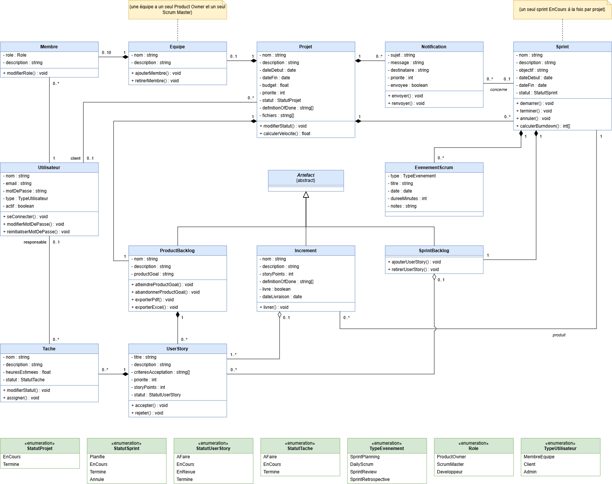

# Scrumly API _(scrumly-api)_


REST API for Scrum project management that enforces the rules of the Scrum Guide 2020.

Scrumly manages projects, Scrum teams, the product backlog, sprints, tasks, Scrum events and increments, with the rules of the [Scrum Guide 2020](https://scrumguides.org/scrum-guide.html) built into the API:

- roles per project: Product Owner, Scrum Master, Developers
- fixed-length consecutive sprints with a locked Sprint Goal
- time-boxed Scrum events
- user stories accepted against the Definition of Done, generating increments
- burndown chart, velocity, PDF and Excel exports of the product backlog

Built with Node.js, Express and MongoDB (Mongoose), secured with JWT and documented with OpenAPI (Swagger UI).

Developed between late 2024 and early 2025 as an academic project.

**Live demo:** [scrumly-api.onrender.com/api-docs](https://scrumly-api.onrender.com/api-docs)

## Install

Requires [Node.js](https://nodejs.org/) 22 and a MongoDB database that supports transactions (ex: a free [MongoDB Atlas](https://www.mongodb.com/atlas) cluster).

```bash
git clone https://github.com/Doua-Gannouni/scrumly-api.git
cd scrumly-api
npm install
cp .env.example .env
```

Fill in `.env`: `DATABASE` and `JWT_SECRET_KEY` are required, the other variables are described in [.env.example](.env.example). To call the API from a web page, also set `CORS_ORIGINS` (allowed origins, separated by commas).

## Usage

```bash
npm run dev    # development: restarts when a file changes
npm start      # production
```

The documentation of every endpoint is available at `http://localhost:7000/api-docs`. Log in with `POST /auth/login`, then send the token in the `Authorization: Bearer <token>` header.

## Architecture

Layered Express application, each layer has one job:

```
routes → middlewares → controllers → services → models
         (auth, role)   (HTTP only)   (Scrum rules)
```

### Class diagram

Domain model of the application, implemented by the Mongoose models of `models/`:



## Maintainers

Doua Gannouni · [GitHub](https://github.com/Doua-Gannouni) · [Portfolio](https://portfolio.doua-automation.xyz/)

## Contributing

Questions and bug reports: open an [issue](https://github.com/Doua-Gannouni/scrumly-api/issues). Pull requests are welcome.

## License

[MIT](LICENSE) © Doua Gannouni
